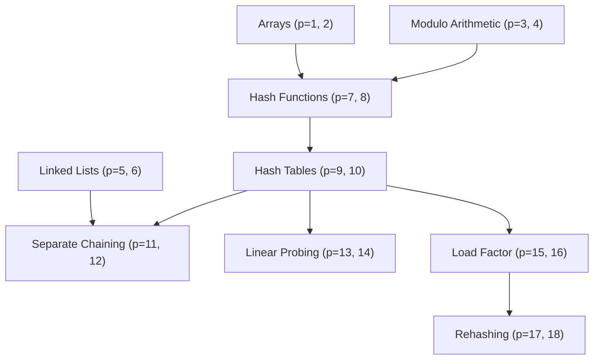

# MistakeMirror — Intelligent Prerequisite Tutor & 3D MirrorPet companion

[](https://www.python.org/)
[](https://fastapi.tiangolo.com/)
[](https://react.dev/)
[](https://threejs.org/)
[](https://vitejs.dev/)
[](https://opensource.org/licenses/MIT)

MistakeMirror is an AI-powered diagnostic learning platform that identifies **WHY** a student answered a problem incorrectly, traces the mistake through an interactive prerequisite Knowledge Graph to the root-cause topic, challenges false mental models with counter-examples, and motivates students with **MirrorPet** — a customisable, animated 3D companion living inside their profile.

---

## 🌟 Key Features

1. **3D MirrorPet Virtual Companion**
   - Rendered in Three.js in a dedicated section of the student profile (**separate from student avatar and account identity**).
   - Features procedural idle breathing, eye blinking, levitation bobbing, and click/tap interactive wave & cheer animations.
   - Off-screen pause optimization via `IntersectionObserver` to preserve battery and GPU resources on mobile and laptops.
   - Wardrobe & Style Shop with 12 items: 4 Outfits, 5 Accessories, and 3 Visual Effects (sparkles, glowing auras, particle trails).
   - 5 color themes: Cosmic Violet, Emerald Glade, Cyber Cyan, Solar Gold, Radiant Pink.
   - Milestone-exclusive unlocks (e.g. *Arch-Mage Cloak* requires resolving misconceptions; *Golden Halo* requires scoring 80+ in TeachBack AI).

2. **Tamper-Proof Learning Points Economy**
   - Students earn points exclusively through validated learning activities:
     - Practice Answer: **+10 pts**
     - Misconception Recovery via Counter-Example: **+25 pts**
     - Socratic TeachBack AI Session: **+20 to +30 pts**
     - Course Notes Ingestion: **+15 pts**
   - Idempotent backend transaction ledger prevents duplicate payouts, negative balances, and unauthorized modifications.

3. **Prerequisite Knowledge Graph & Root-Cause Diagnosis**
   - Diagnostic labels (`ROOT CAUSE`, `SYMPTOM`, `OK`) are kept distinct from Bayesian mastery probabilities ($p$).
   - Scripted Demo Q1: Tested Topic `hash_table`, Root Topic `modulo`.
   - Misconception Answer `25` highlights Modulo in **RED** ($p = 0.30$) and Hash Tables in **AMBER** ($p = 0.40$).
   - Correct Counter-Example Answer `5` updates Modulo to **$p = 0.475$ (AMBER)** strictly following Bayesian formula — **not artificially forced to green**.
   - Directed prerequisite dependency edges animate in pulsing red.

4. **Socratic TeachBack AI with Voice Input**
   - Flip the classroom: the student teaches a curious, naive AI junior student ("Junior").
   - Integrated with Web Speech API for hands-free voice explanation.
   - Evaluates clarity, detects misconceptions, and awards scores from 0 to 100 with pedagogical feedback.

5. **Open-Source & Offline AI Architecture**
   - **Groq API**: Blazing-fast open-weight LLMs (`llama-3.3-70b-versatile`, `llama-3.1-8b-instant`).
   - **Ollama**: 100% free and offline local open-source LLM (`llama3.2`).
   - **Deterministic Offline Fallback (`USE_MOCK_LLM=true`)**: Complete zero-cost offline mode with zero external API dependencies.
   - Pydantic schema validation with automatic retry and DAG topic ID verification.

6. **Notes-Based Learning & OCR**
   - Upload course notes in PDF, PPTX, or image formats.
   - Generates an editable preview draft (topics, prerequisite edges, MCQ questions, source pages) before committing to the database.
   - OCR fallback for images and scanned documents.

7. **Bilingual Support & Spaced Repetition**
   - Full English and தமிழ் (Tamil) bilingual explanations with technical terminology preserved.
   - Leitner/SM-2-style spaced repetition revision schedule (1, 3, and 7-day intervals).

---

## 📚 Curriculum & Knowledge Graphs

### Primary Subject: Data Structures — Hashing


### Secondary Subject: Simple Maths Problem Solving (Preserved)
- `arithmetic_basics` → `multiplication` → `order_of_operations` (PEMDAS) → `linear_equations` → `word_problems`.

---

## 🎯 Scripted Demo Walkthrough

1. **Load Demo (Q1)**:
   - Click **Load Demo (Q1)** in the sidebar footer.
   - Scripted Question:
     > *"Insert key 25 into a table of size 10 using h(k) = k % 10. Which index?"*
2. **Submit Misconception**:
   - Select option **`25`** and click **Submit Answer**.
   - Diagnosis explanation appears:
     > *"You answered 25 because you treated the hash value as the original key. The root cause is misunderstanding modulo wrap-around."*
3. **Inspect Knowledge Graph**:
   - Navigate to **Root-Cause Map**.
   - **Modulo Arithmetic** pulses in **RED** ($p = 0.30$) with the **ROOT CAUSE** badge.
   - **Hash Tables** is highlighted in **AMBER** ($p = 0.40$) as **SYMPTOM**.
4. **Solve Counter-Example**:
   - Return to **Practice** and answer the counter-example:
     > *"What is 25 % 10? Calculate the integer remainder when 25 is divided by 10."*
   - Select **`5`** and submit.
   - Student earns **+25 points** for resolving the misconception!
   - Modulo recovers to **$p = 0.475$ (AMBER)**.
5. **TeachBack AI**:
   - Navigate to **Teach-back** and explain modulo arithmetic to Junior (using typing or the microphone voice button).
   - Complete session to earn **+30 points** and review pedagogical feedback.
6. **MirrorPet Profile & Wardrobe Shop**:
   - Click your profile badge in the header or **Profile & Pet** in the sidebar.
   - View your 3D pet **Lumi** breathing and bobbing in the dedicated 3D arena.
   - Tap Lumi to trigger a cheer wave animation!
   - Click **Open Wardrobe & Shop** to preview 3D outfits and accessories.
   - Spend earned points to unlock the **Hero Cape** or **Cool Shades** and equip them live onto the 3D pet!

---

## 🚀 Quick Start Guide

### Prerequisites
- Python 3.10+
- Node.js 18+ and npm

### 1. Backend Setup
```bash
cd backend
python -m pip install -r requirements.txt
python -m uvicorn app.main:app --reload --port 8000
```
- API Health: `http://127.0.0.1:8000/api/health`
- Interactive Swagger Docs: `http://127.0.0.1:8000/docs`

### 2. Frontend Setup
```bash
cd frontend
npm install
npm run dev
```
- Web Application: `http://localhost:5173`

---

## ⚙️ AI Configuration (.env)

MistakeMirror works 100% offline without any API keys by default. To enable live LLM generation:

```bash
# In backend/.env

# Default: Deterministic offline mode (Free, Zero API keys)
USE_MOCK_LLM=true

# Option A: Open-Source AI via Groq (Fastest Llama 3.3 70B - Free tier at console.groq.com)
USE_MOCK_LLM=false
LLM_PROVIDER=groq
GROQ_API_KEY=gsk_your_groq_api_key_here
GROQ_MODEL=llama-3.3-70b-versatile

# Option B: 100% Local Open-Source AI via Ollama
USE_MOCK_LLM=false
LLM_PROVIDER=ollama
OLLAMA_BASE_URL=http://localhost:11434
OLLAMA_MODEL=llama3.2
```

---

## 🧪 Testing & Verification

### Backend Unit Tests (26 / 26 Passing)
```bash
cd backend
python -m pytest tests -v
```
Covers:
- Bayesian mastery updates & status boundary transitions
- Careless slip precedence & non-propagation
- Knowledge DAG cycle prevention and validation
- Pydantic schema validation & LLM fallback triggers
- MirrorPet profile setup, inventory, and atomic purchase logic
- Milestone-exclusive cosmetic locking & idempotent point rewards

### End-to-End Demo Flow Verification (12 / 12 Steps Passing)
```bash
python verify_flow.py
```
Verifies complete flow from Q1 misconception to graph coloring, counter-example recovery, TeachBack session, bilingual Tamil mode, progress analytics, and MirrorPet cosmetic purchase & equipping.

---

## 📄 License & Attribution

- **License**: MIT License.
- **Three.js**: MIT License (procedural 3D rendering with zero external CDN dependencies).
- **Lucide Icons**: MIT License.
- **FastAPI / SQLAlchemy**: MIT License.
